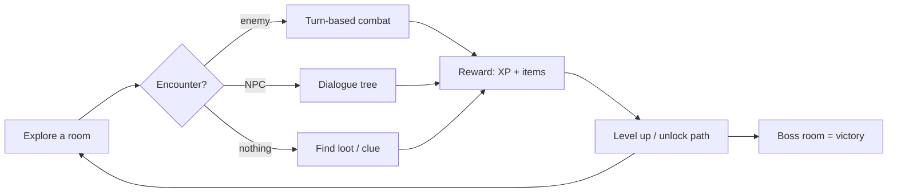

# [Game Title] — Project Proposal & Scope Agreement

- **Team:** [Team name]
- **Members:** [Student A name], [Student B name]
- **Course:** [Course code and name]
- **Demo date:** [Date]
- **Status:** v0.1 — last updated [date]

> Team rule: **if it's not in this document, it's not in the game.**
> To change anything here, use the process in Section 10.

---

## 1. Vision

A text-based dungeon-crawler RPG that runs entirely in the terminal. A player
explores a connected world of rooms, talks to NPCs with branching dialogue,
fights enemies in turn-based combat, collects loot, levels up, and defeats a
boss. All content (rooms, items, enemies) lives in JSON files so the game can
grow without touching code — and so the world could later be reused by a
JavaScript front end.

A play session should feel like this:

```text
You are in the Torch-lit Hallway. Exits: north, east.
> north

You enter the Goblin Storeroom. A Goblin Scout notices you!
[Combat begins — you strike for 7 damage]
The goblin hesitates... it looks like it wants to flee.
> talk
The goblin: "Please! Take the rusty key and leave me alive!"
```

### Goals (why we're doing this)

1. Learn OOP: classes, composition, and state tracking across modules.
2. Ship a complete, playable game — start screen to boss victory.
3. Practice team Git workflow: branches, pull requests, code review.
4. Build with clean module interfaces so parts can be swapped or ported later.

---

## 2. Scope

### In scope (v1.0)

- Single-player terminal RPG, keyboard input only (`print` / `input`).
- A connected map of ~8–12 rooms with locked doors and items to find.
- Turn-based combat: attack, defend, use item, attempt to talk/flee.
- At least 3 enemy types with different behaviors (aggressive, cautious, flees
  at low HP).
- At least 2 NPCs with branching dialogue trees (one gives a quest or hint).
- Items: weapons, armor, potions. XP and leveling with stat growth.
- A win condition (defeat the boss) and a lose condition (HP hits 0).
- Save/load between runs (stretch goal — cut first if time runs short).

### Out of scope (v1.0) — tempting things we are NOT building

| Idea | Why not now |
|---|---|
| Graphics, colors, sound | Terminal-first design; huge time sink |
| Networked multiplayer | Requires networking we haven't learned; revisit with JS port |
| Web / browser version | Post-v1.0 goal, parked in Section 7 |
| Crafting systems, skill trees | Content bloat; core loop first |
| Procedurally generated maps | Hand-designed map is enough and easier to debug |
| Database for saves | A JSON save file is enough |

---

## 3. The Core Loop

Everything we build serves one arrow in this diagram. If a feature doesn't
connect to it, it probably doesn't belong in v1.0.



---

## 4. Roadmap

M1–M3 happen **in parallel** — that's the point of the module split.

| ID | Milestone | Target date | Done when (demo-able) | Lead |
|---|---|---|---|---|
| M0 | Skeleton | [date] | Both clone the repo, `python main.py` prints a welcome, `pytest` runs | Both |
| M1 | Walkable world | [date] | Player moves between 5+ rooms; `look` describes each; invalid moves rejected | A |
| M2 | Combat works | [date] | A test encounter runs a full battle: attack/defend/item, win or lose correctly | B |
| M3a | Enemy behaviors | [date] | Enemies flee, heal, or press attack based on their HP and type | B |
| M3b | NPC dialogue | [date] | One NPC has a 3-level dialogue tree that reveals a hint or quest | A |
| M4 | Integration | [date] | Full loop works: movement triggers real combat against real AI; XP persists | Both (pair-program) |
| v1.0 | Demo build | [date] | New player beats the game in ~10 min with no crashes; README explains setup | Both |

**Cut order if we fall behind:** save/load → second NPC → extra enemy types →
locked doors. Never cut: combat, one enemy behavior set, one dialogue tree,
a win state.

---

## 5. Team & Ownership

| Area | Files | Owner |
|---|---|---|
| Engine & map | `game/engine/` | A |
| NPCs & dialogue | `game/ai/npc.py`, `game/ai/dialogue.py` | A |
| Combat & stats | `game/combat/` | B |
| Enemy behavior | `game/ai/enemy_ai.py` | B |
| Data files | `data/` | Both (content tweaks are free for anyone) |
| `main.py`, `docs/interfaces.md` | root | Changed only by mutual agreement |

The theme: **A owns the world** (rooms and the characters you talk to),
**B owns the rules** (fights and how enemies behave inside them). The shared
`game/ai/` folder straddles both halves — one owner per file, so no conflicts.

**Backups:** with two people, each of us *is* the other's backup. That makes
the last checkbox in Section 9 non-negotiable — both of us must be able to
explain and modify either half.

---

## 6. Architecture Decisions

| Decision | Choice | Reason | Revisit when |
|---|---|---|---|
| Language | Python 3.12, stdlib only | Course requirement; zero install issues | Never for v1.0 |
| UI | Terminal; all `print`/`input` at the edges (`main.py`, `game_loop.py`) | Keeps logic testable; enables future port | JS port |
| Content | JSON files in `data/` | Edit game content without code; JSON survives a JS port | If content gets huge |
| Module contracts | Documented in `docs/interfaces.md` before coding apart | Prevents "doesn't fit together" disaster week | Each milestone |
| Testing | `pytest`, one test file per area | Each of us verifies our own code | — |
| Multiplayer | None in v1.0 | Networking not learned yet; biggest scope-creep risk | Post-v1.0 |

---

## 7. Future: JavaScript Port (parking lot)

After v1.0, we may rebuild the front end in JavaScript for the browser. The
JSON data files and the module split are designed to survive that port
unchanged. **Until v1.0 ships, nothing in this section gets built.**

Parking lot (ideas captured here so they stop distracting us):

- Browser UI rendering the same `data/*.json` world
- A second player: hot-seat or networked
- Simple tile/sprite graphics
- Procedural room generation

---

## 8. Ground Rules

- **Git:** work on `feature/<area>-<thing>` branches; the other person reviews
  before merging into `main`; `main` is always runnable. (With two people this
  means 100% review coverage — free benefit, don't skip it.)
- **Tiebreaker:** if we disagree on something for more than ~15 minutes, we
  take the **simpler option**, note it in the changelog, and move on. If it
  really matters, ask the TA — we have no third vote, so this rule replaces one.
- **Meetings:** weekly, [day/time]; notes in `docs/meeting-notes/YYYY-MM-DD.md`.
  Short meetings are fine; missed ones are not.
- **Decisions:** anything agreed in chat gets written into this file or it
  didn't happen.
- **Stuck for more than 2 hours?** Message the other — that's what the team is for.
- **Can't make a deadline?** Say so early — there is no third person to quietly
  absorb the work.

---

## 9. Definition of Done

A feature/module is done only when all of these are true:

1. It works when demoed from `main.py`, not just in isolation.
2. It has at least a few `pytest` tests that pass.
3. Anything the other half relies on is written into `docs/interfaces.md`.

The **project** is done when:

- [ ] A new player can install per the README and beat the game in ~10 minutes
- [ ] A full playthrough has no crashes
- [ ] All tests pass (`pytest`)
- [ ] Both of us can explain and modify *either* half of the codebase — not
  just our own

---

## 10. Scope Change Process

Scope drift kills group projects, so changes go through this gate:

1. Write a short proposal in the chat (what, why, estimated time).
2. Discuss at the next meeting (or both agree in chat — no majority needed,
   both of us must say yes).
3. If accepted: update this document, bump the version below, note it in the
   changelog.
4. If it can wait: it goes to the parking lot in Section 7 instead.

**Default answer to new ideas before M4: "parking lot."**

---

## Changelog

| Version | Date | Change | Agreed by |
|---|---|---|---|
| 0.1 | [date] | Initial proposal | A, B |